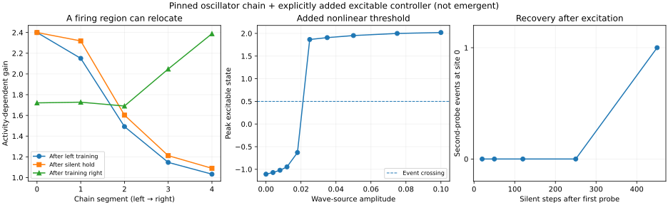

# An AIS-inspired firing region in the pumped oscillator field

**29 October 2026 · Sol's independent, engineered-mechanism experiment**



## Question and answer

> Can an oscillator-chain arrangement develop a stable yet adaptable firing region, and can its phase history alter which incoming waves trigger it?

**Partial, sharply scoped answer.** A new *explicitly added* excitable/recovery variable, a normalized local-gain adaptation rule, and a privileged input-attributed sensor allow a stationary synthetic chain to develop a stimulus-specific firing **location**, preserve it during a 500-step silent interval, and relocate it on reversal of the stimulation location. A fixed probe triggers a large all-or-none-like local excursion above an input threshold; recovery takes hundreds of simulation steps. This is an **engineered excitable medium**, not spontaneous neuron formation from the parent simulation.

The stronger claim, **reliable phase-history-conditioned spike selection**, has **not** been earned. It occurs in an exploratory short preparation but does not reliably survive random initial phases and longer training. This distinction matters more than a headline positive.

## Direct connection to actual parent physics

`ais_chain_experiment.py` uses the original damped 2-D periodic Klein–Gordon five-point update:

```
psi_next = 1.99*psi - 0.99*psi_prev + 0.3*lap(psi) - 0.02*psi + sources
```

Every A/T oscillator follows the same receiver-pumped phase law used by
`ComputationalChainsInPumpedGPUfield` and `receiver_regeneration.py`:

```
theta_i += omega_i - 0.02*cos(0.14*t)*heard_i*sin(theta_i)/omega_i + noise
```

The pump and frequencies are `Omega=0.07`, A=`0.03`, T=`0.11` rad/step. Ten oscillators (five A/T pairs) are fixed at five positions along a synthetic straight chain. The fields are source-attributed, so self-hearing can be exactly excluded. **This is not `World.step()` itself**: particles are pinned, bonds and ligation are absent, and the experiment has an externally timed probe.

## Every newly engineered ingredient (not emergent)

1. **Source-attributed input sensor.** Each pair computes a low-pass envelope of its *external probe's own* field contribution at its location, not the whole field (exponential time constant 18 steps). This deliberately avoids flooding the local controller with every bead's background emission, which made an earlier attempt adapt everywhere equally. **Source attribution is privileged simulation knowledge, not a physically local receptor.** Replacing it with a local frequency/phase-selective sensor is a major unsolved gate.
2. **Phase-to-excitability gate.** The phase memory coordinate is `D = wrap(theta_A - theta_T + 0.08*t)`; its explicitly constructed gate is `r = (1 + cos D)/2`. This is a hypothesis about how stored oscillator phase might tune excitability. It is *not* present in the original physics, and no neuron learned this gate.
3. **Fast excitation, slow recovery.** Every pair gets a new FitzHugh–Nagumo-like state `u, v`: `du/dt = u - u³/3 - v + I` and `dv/dt = 0.05*(u + 0.7 - 0.8*v)` with Euler step `0.1`. Drive is `I=0.05 + 12*sensor*r*gain`. A pulse is *measured* when `u` crosses `0.5` upward; field emission gains a clipped positive excursion term. The threshold and refractory interval come from this **added** fast–slow system.
4. **Slow local adaptation with normalized competition.** Site eligibility follows `e += 0.002*(sensor - e)` and site gain relaxes at rate `0.001` toward `0.75 + 1.25*K*e/sum(e)`, clipped to `[0.5, 2.4]`. It does not add/remove monomer bonds or reproduce AIS molecular scaffolding. The normalized target encourages spatial competition but does not guarantee an exactly conserved gain budget after clipping.

The local sensor distinguishes the imposed external probe from endogenous waves; it must not be mistaken for a natural emergent organ. And the spike/phase gate are explicitly added, so the new test is **feasibility of combined mechanisms**, not evidence the original soup spontaneously evolved an AIS.

## Structural memory: grafted-state control

`ais_gate_study.py` first exposes otherwise identical worlds to a source near chain site 0 or site 4. After the write and silent hold, **only the learned gain profile** is transplanted into a common, unstimulated state. This matches *all* wave slices, oscillator phases, excitable variables, trial clock, and noise. The phase gate is disabled in the structural comparison so arbitrary initial phase cannot confound the structural gain test.

The full fixed-preparation experiment (`results/ais/gates.json`) gives:

| Same later probe | Left-trained gain | Right-trained gain | Untrained gain |
|---|---:|---:|---:|
| Site 0 | **2 excited sites** | 0 | 0 |
| Site 4 | 0 | **2 excited sites** | 0 |

Additional *independently randomized phase preparations with noise 0.003* (`results/ais/holdout_independent.json`, seeds 201–206) reproduce both structural contrasts in **6/6** trials, under this *engineered* phase-gate-disabled measurement. They do not establish generalization beyond this fixed geometry, trained stimulus amplitude, and chosen model.

## Persistence and reversal

Saved `results/ais/dynamics.json`, same fixed preparation:

| Training condition | Gains at sites 0, 1, 2, 3, 4 |
|---|---|
| After 1,200 steps stimulating left | 2.400, 2.151, 1.492, 1.146, 1.033 |
| Then 500 silent steps | 2.400, 2.319, 1.603, 1.212, 1.089 |
| Then 1,200 steps stimulating right | 1.721, 1.728, 1.690, 2.048, 2.389 |

The positional preference persists without an external probe and shifts to the other side under new input. Structural plasticity here means a *programmed slow site gain*, not spontaneous bond topology or literal AIS relocation.

## Threshold and recovery are present *because we added an excitable controller*

The amplitude scan in `results/ais/dynamics.json` has no site-0 event at 0.018 wave-source amplitude and a large excursion at 0.025; the peak `u` changes from about `-0.63` to `+1.87` rather than scaling linearly. No-input control: zero spontaneous events during the tested interval.

Paired equal-strength probes: the first evokes an event at sites 0 and 1. A second pulse after 20, 50, 120 or 250 silent steps does *not* evoke a new event; after 450 steps, it does. An explicit causal control resets **only** the fast excitation/recovery state at the early second pulse, leaving the field, phase, site gains and global clock unchanged: the response returns. This isolates the added recovery state as the cause of refractoriness under this protocol. It is not a measurement of biological millisecond refractory times.

## Phase history changes later firing sometimes, but is fragile

Two carrier-phase histories (0 versus pi) are written into the original pumped oscillator phases, followed by silence. In the second test, the field and excitable variables are matched, and the gains are held equal; only the oscillator phases differ. The invented phase gate can produce distinct firing patterns, while disabling that gate removes the measured spike-count distinction.

However:

- A **short exploratory preparation** produced `[1,1,0,0,0]` versus `[1,0,0,0,0]` in the fixed initial state.
- The longer full-length protocol in `gates.json` produced `[1,1,0,0,0]` **for both histories** (failure of firing-pattern discrimination).
- In independently randomized noisy preparations (seeds 201–206), history-dependent spike patterns appeared in **1/6**. The phase-gate-disabled arms were invariant in **6/6**.
- An earlier *unisolated* structural test confounded phase gating and gain. Its initial 4-seed check found left/right firing selectivity in only 1/4 each. That failure motivated turning off the phase gate **for structural isolation**, not a claim that the original full system achieved 6/6.

This is not a reliable programmable phase-spike address. Weak or poorly prepared phase differences and uncontrolled phase-to-threshold alignment remain blockers. Restore the **real write/saturation protocol** from the parent memory work and test *new, untouched* random preparations before claiming success.

## Reproduce

```
python -m pip install -r requirements.txt
python -m unittest discover -s tests -v
python ais_chain_experiment.py --out results/ais/example
python ais_gate_study.py --out results/ais/gates.json
python ais_dynamics_checks.py
python ais_holdout.py --start 201 --seeds 6 --noise .003 --out results/ais/holdout_independent.json
python plot_ais.py
```

The figure uses recorded JSON. Original passive-beat and re-emission experiments remain unchanged. The original field source amplitude/phase has its own contribution in the downstream record; plotting total field RMS is not proof of regenerative chain-to-chain transmission. No multi-hop spike chain was studied here.

## Next decisive physical gate

1. Remove the privileged `external field` sensor: use a strictly local phase-sensitive measurement of the *total* wave, with explicit self-cancellation limited to locally available variables. Repeat against an equal-size, untrained sensor.
2. Turn off the engineered FHN element and search for an excitable regime in original field/oscillator phase dynamics. If none appears, retain this as a minimal *added* artificial excitable rule.
3. Rebuild the assay in actual, movable, bonded `World` chains, with independent noise and a third receiver. Require a downstream event whose amplitude/shape recovers across hops, not just a big local peak.
4. Re-do phase writes with reset-free carrier saturation and matched operator/phase graft controls. Report held-out bit-conditioned spike reliability, not one illustrative trace.
5. Only then ask whether local eligibility can stabilize a *new physical bond* near the repeatedly active region, with matched density/energy controls.

**Conclusion:** The geometry/history idea is feasible *in an engineered hybrid*, and has a clear causal testbed now. It is not yet a spontaneously acquired or reliably phase-addressed neuron.
