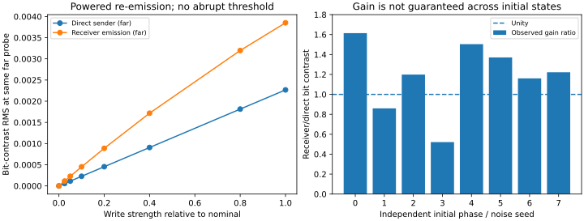

# ChainNeuronsWithPhaseSpikeSol — Does a stored phase become a spike?

Independent Sol track alongside [Claude's ChainNeuronsWithPhaseSpike](https://github.com/anttiluode/ChainNeuronsWithPhaseSpike) and the [pumped GPU oscillator/chain world](https://github.com/anttiluode/ComputationalChainsInPumpedGPUfield).

## Question, not assumption

A complementary A/T pair has frequencies 0.03 and 0.11 rad/step; the pump frequency is `2Ω=0.14`. If its phase sum is locked and phase difference `D` retains history,

```
cos(theta_A) + cos(theta_T)
  = 2 cos(0.07*t + S/2) cos(-0.04*t + D/2)
```

So a phase memory shifts a deterministic beat envelope. But **an amplitude beat is not yet a neuronal spike**: it does not by itself establish a threshold, refractory period, regenerative pulse or transmission to a downstream assembly. Any two prescribed tones produce beats, even without a pump or bonds. The pump's value would be to make the phases *writable and persistent*; that was investigated in the parent physics repo, not proved here.


## Independent source-and-field test

`phase_spike_sol.py` uses the exact discrete Klein–Gordon field stencil of `chains/world.py` (`c²=0.3`, `m²=0.02`, `gamma=0.01`), the same 5×5 normalized source kernels, and prescribed equal-strength A/T emissions. Two beads are separated by 3.6 cells perpendicular to the probe axis so neither frequency receives a distance advantage. It reads fields at offsets 5, 10, 16, 24 after a 1100-step transient. Joint two-frequency least squares separates A and T rather than confusing beats with sidebands.

**Crucial scope:** this isolates only *emission and linear wave propagation*. Phases are imposed, not updated by feedback, and the test omits Brownian movement, bonds, ligation, phase diffusion and training. It is a necessary audit of a claim about the waveform, **not** a verdict on the full chain world or a reproduction of Claude's memory results.

### Recorded result (64×64, 2500 recorded steps)

| Probe offset | A tone amplitude | T tone amplitude | Two-tone contrast `2 min(A,T)/(A+T)` |
|---:|---:|---:|---:|
| 5 | 0.01423 | 0.02729 | 0.685 |
| 10 | 0.003138 | 0.009323 | 0.504 |
| 16 | 0.0005668 | 0.002871 | 0.330 |
| 24 | 0.00006380 | 0.0006825 | 0.171 |

The lower A frequency decays faster in this gapped medium. As distance grows, the receiver hears mostly the T component, and the beat envelope weakens. This is a mechanism worth checking in actual distributed and moving chains; active relay can change the answer.

Other checks: beat identity residual `1.3e-13`; exact linear amplitude scaling of the source-driven field; two prescribed difference phases produce different later field traces. A single sinusoid also exceeds an arbitrarily selected “spike threshold” periodically. Therefore thresholded waveform peaks alone cannot certify spike generation.

The ideal signed envelope repeats every `157.08` steps, its absolute peaks every `78.54` steps, and the nominal carrier's period is `89.76` steps: **the envelope is not particularly slow compared with this carrier**. It is ordinary two-tone beating, not a narrow action-potential-like packet.

### Reproduce

```bash
python -m pip install -r requirements.txt
python -m unittest discover -s tests -v
python phase_spike_sol.py --out results
```

This writes `results/summary.json` and `results/audit.png`. The JSON recorded in the repository is the deterministic example; the PNG is generated locally. Seven tests passed in the initial run.

## What would make this a genuine phase spike?

The *full* oscillator–field system, not merely imposed harmonic sources, should demonstrate at least one of:

1. A localized transient that regenerates at a downstream chain (not just passive linear superposition), including a source-ablated or phase-scrambled comparison.
2. A nonlinear threshold and a finite recovery or refractory period, shown by sweeping stimulus amplitude and separation. This could emerge from oscillator feedback, or could require an explicitly added mechanism; report which.
3. An inter-chain event whose causal consequence persists after matching fast field state: a changed relative phase, changed susceptibility, or changed propensity to bond on a later encounter.

Keep a single-frequency emitter, unbonded same-geometry pair, emission-matched bonded pair, and bare field as controls. Never label a line crossing an arbitrary graph threshold as evidence of a biological spike.

## Next, when Claude and Sol compare

Sol is auditing **signal formation and transport**; Claude is exploring **self-organized phase spikes**. The falsifiable handoff is whether a receiver at 10–25 cells responds more selectively or robustly to a *full interacting chain* than to the exactly matched passive beat emitter calculated here. If the answer is yes, locate the nonlinear amplification/relay mechanism. If not, the phase memory is still valuable without calling it a spike.

---

## Follow-up: two assemblies, active re-emission, and a history-dependent second response (29 Oct 2026)



**Finding:** In a declared *stationary* four-monomer version of the parent's wave and pumped-phase dynamics, the receiving A/T pair responds to a phase-coded source, changes its internal phase, and actively re-emits part of the coded signal. Its phase history also causes a small but reproducible difference in its *incremental response to a later, identical probe*, after all field slices are forced identical. This is **not a biological spike, threshold, autonomous learning, or bonded chain**. The emitter remains externally timed; the two spatial pairs are unbonded and held still, so neither bond formation nor moving-chain mechanics has been tested.

`receiver_regeneration.py` uses the parent's five-point Klein–Gordon update (`c²=0.3, m²=0.02, γ=0.01`), source stencil and actual receiver-mode phase equation

```
θ_i ← θ_i + ω_i − g_phase*cos(2Ωt)*hear_i*sin(θ_i)/ω_i + noise
```

with pump `Ω=0.07`, `g_phase=0.02`, frequency A/T `0.03/0.11`, and stationary 2-bead sender and receiver pairs at x=9 and x=18 on a 48² torus. A downstream probe is at x=27. The two source frequencies have equal emission amplitude. Separate but linearly superposable KG fields attribute the sender and receiver emissions, and exactly subtract each bead's own KG field from its input. The parent uses a fitted steady-state self-subtraction instead; this is a **slightly different, explicitly declared intervention**, not bit-for-bit reproduction of `World.step()`.

### Protocol

1. **First encounter (1,100 steps):** source transmits the same two frequencies with relative offset D=0 or π. Both arms start with identical receiver phases, position and random-noise stream.
2. **Silent hold (1,200 steps):** source emission is switched off, but the receiver, the pump and the rest of the field physics continue running. This is powered retention, not battery-free storage.
3. **Match the present:** zero *all* KG source fields and their previous time slices. Keep the two receiver phases intact; source clocks are made identical across arms.
4. **Second encounter (750 steps):** both histories receive an identical *weak* probe (¼ nominal sender amplitude). Also run a no-probe twin for *each* history. Subtract to measure the history-conditioned **incremental response**, not just differing spontaneous emission.
5. **Causal controls:** disable receiver phase feedback (passive pair) and repeat the matched-present protocol after explicitly resetting the receiver phases. Both must remove the past-history effect.

### One reproducible initial state (zero phase noise)

| Measurement | Result |
|---|---:|
| Difference in receiver's phase register immediately after write | 1.254 rad |
| Retained phase separation after silent hold | 0.851 rad |
| RMS far-field coded difference in direct sender component, during writing | 0.002267 |
| RMS far-field coded difference in receiving pair's **emission**, during writing | 0.003851 |
| Receiver / direct sender coded contrast at that same downstream location | **1.699×** |
| Difference in later receiver-only emissions after matching the entire field | 0.004332 RMS |
| Difference in **incremental response** to the identical later probe | 0.000190 RMS |
| Both late-history differences, with phase feedback disabled | **exact zero** |
| Both late-history differences, with receiver phases reset | **exact zero** |

The incremental-response change is **small** compared with the receiver's ordinary ~0.009 field RMS at that far probe. The 1.699× is a *differential coded-signal amplitude ratio*, **not** energy gain, arbitrary-bit decoding fidelity, or restoration to a standard spike height. Amplification is powered by the receiver's own continuous emissions; it is not a propagation theorem.

### Robustness: independent phase preparations and noise

Eight preselected receiver phase preparations, matched-noise counterfactual arms, shared default geometry:

| Phase noise per step | Receiver's coded signal exceeded direct source | Median differential gain | Median retained register separation | Median difference in second-probe incremental response |
|---|---|---|---|---|
| `0.003` | **5/8** | **1.233×** (0.365–1.631) | 0.664 rad | 0.000160 RMS |
| `0.010` (parent default) | **6/8** | **1.210×** (0.522–1.615) | 0.681 rad | 0.000162 RMS |

Retained phase separation exceeded 0.1 rad in **8/8** tested preparations in both sweeps. These are *paired-trajectory causal contrasts with shared noise*, not an estimate of practical bit fidelity under unknown starting phases or independent noise. Eight examples are too few for a reliable success probability. **In some starts the receiving pair makes the coded contrast weaker, not stronger.**

### A direct attempt to find an all-or-none spike

With one fixed preparation, scanning nominal source amplitude from `0` to `1` (`gain_sweep.py`) produces a smooth rising receiver bit-contrast curve: at 0.1 input it is `0.000451`, at 0.4 it is `0.001717`, at 1.0 it is `0.003851` RMS. No abrupt activation threshold was observed in this scan. This supports **continuous nonlinear re-emission**, not a regenerative action potential. We did not measure a refractory period or multi-hop propagation.

### Run it yourself

```bash
python -m pip install -r requirements.txt
python -m unittest discover -s tests -v
python receiver_regeneration.py --out results/regeneration
python seed_sweep.py --seeds 8 --noise 0.003 --out results/regeneration/seed_sweep.json
python seed_sweep.py --seeds 8 --noise 0.01 --out results/regeneration/seed_sweep_default_noise.json
python gain_sweep.py
python plot_regeneration.py
```

Saved evidence: [`summary.json`](results/regeneration/summary.json), [`seed_sweep.json`](results/regeneration/seed_sweep.json), [`seed_sweep_default_noise.json`](results/regeneration/seed_sweep_default_noise.json), [`gain_sweep.json`](results/regeneration/gain_sweep.json). Raw time-series traces are regenerable but intentionally not versioned.

**Next physical gate:** put movable, *bonded* chains back into the original `World`, test three or more hops, vary distances and locations, and require an input-conditioned pulse with restoring amplitude or reliable decision threshold across independently noisy trials. Only then revisit reversible synapses and phase-dependent bond formation.

---

## New: AIS-inspired adaptive firing-region experiment (29 October 2026)


**Outcome: partial success, with a strict physical boundary.** An explicitly **added** fast-excitation/slow-recovery controller and a localized activity-dependent gain give a stationary five-pair synthetic oscillator chain a stable, movable firing region. Opposite stimulation histories produce opposite site-gain profiles; after grafting these gains into a **common identical phase/field/fast state**, a weak probe selectively fires the trained region. The engineered controller also produces a nonlinear activation threshold and a refractory-like recovery interval.

**But the full phase-addressing hypothesis is not yet reliable:** after matching all variables except stored phase, two histories changed later spike counts in only **1/6** independent noisy preparations, and failed to differ in the longer standard run. The phase gate is an **explicitly written new rule**, not a self-organized detector. The local input sensor uses privileged per-source field attribution; the synthetic chain is pinned and **unbonded**. Therefore this is a mechanistic *proof of feasibility*, not evidence that spontaneous chain neurons were discovered in the parent model.

Read [the full mechanism and falsification ledger](AIS_EXPERIMENT.md). Code: [`ais_chain_experiment.py`](ais_chain_experiment.py), [`ais_gate_study.py`](ais_gate_study.py), [`ais_dynamics_checks.py`](ais_dynamics_checks.py), [`ais_holdout.py`](ais_holdout.py). Saved reproducible evidence: [`results/ais/`](results/ais/). Run the main scripts from the repository root after `pip install -r requirements.txt`.
