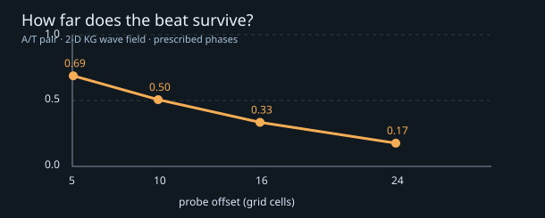

# ChainNeuronsWithPhaseSpikeSol — Does a stored phase become a spike?

Independent Sol track alongside [Claude's ChainNeuronsWithPhaseSpike](https://github.com/anttiluode/ChainNeuronsWithPhaseSpike) and the [pumped GPU oscillator/chain world](https://github.com/anttiluode/ComputationalChainsInPumpedGPUfield).

## Question, not assumption

A complementary A/T pair has frequencies 0.03 and 0.11 rad/step; the pump frequency is `2Ω=0.14`. If its phase sum is locked and phase difference `D` retains history,

```
cos(theta_A) + cos(theta_T)
  = 2 cos(0.07*t + S/2) cos(-0.04*t + D/2)
```

So a phase memory shifts a deterministic beat envelope. But **an amplitude beat is not yet a neuronal spike**: it does not by itself establish a threshold, refractory period, regenerative pulse or transmission to a downstream assembly. Any two prescribed tones produce beats, even without a pump or bonds. The pump's value would be to make the phases *writable and persistent*; that was investigated in the parent physics repo, not proved here.



## Independent source-and-field test

`phase_spike_sol.py` uses the exact discrete Klein–Gordon field stencil of `chains/world.py` (`c²=0.3`, `m²=0.02`, `gamma=0.01`), the same 5×5 normalized source kernels, and prescribed equal-strength A/T emissions. Two beads are separated by 3.6 cells perpendicular to the probe axis so neither frequency receives a distance advantage. It reads fields at offsets 5, 10, 16, 24 after a 1100-step transient. Joint two-frequency least squares separates A and T rather than confusing beats with sidebands.

**Crucial scope:** this isolates only *emission and linear wave propagation*. Phases are imposed, not updated by feedback, and the test omits Brownian movement, bonds, ligation, phase diffusion and training. It is a necessary audit of a claim about the waveform, **not** a verdict on the full chain world or a reproduction of Claude's memory results.

### Recorded result (64×64, 2500 recorded steps)

| Probe offset | A tone amplitude | T tone amplitude | Two-tone contrast `2 min(A,T)/(A+T)` |
|---:|---:|---:|---:|
| 5 | 0.01423 | 0.02729 | 0.685 |
| 10 | 0.003138 | 0.009323 | 0.504 |
| 16 | 0.0005668 | 0.002871 | 0.330 |
| 24 | 0.00006380 | 0.0006825 | 0.171 |

The lower A frequency decays faster in this gapped medium. As distance grows, the receiver hears mostly the T component, and the beat envelope weakens. This is a mechanism worth checking in actual distributed and moving chains; active relay can change the answer.

Other checks: beat identity residual `1.3e-13`; exact linear amplitude scaling of the source-driven field; two prescribed difference phases produce different later field traces. A single sinusoid also exceeds an arbitrarily selected “spike threshold” periodically. Therefore thresholded waveform peaks alone cannot certify spike generation.

The ideal signed envelope repeats every `157.08` steps, its absolute peaks every `78.54` steps, and the nominal carrier's period is `89.76` steps: **the envelope is not particularly slow compared with this carrier**. It is ordinary two-tone beating, not a narrow action-potential-like packet.

### Reproduce

```bash
python -m pip install -r requirements.txt
python -m unittest discover -s tests -v
python phase_spike_sol.py --out results
```

This writes `results/summary.json` and `results/audit.png`. The JSON recorded in the repository is the deterministic example; the PNG is generated locally. Seven tests passed in the initial run.

## What would make this a genuine phase spike?

The *full* oscillator–field system, not merely imposed harmonic sources, should demonstrate at least one of:

1. A localized transient that regenerates at a downstream chain (not just passive linear superposition), including a source-ablated or phase-scrambled comparison.
2. A nonlinear threshold and a finite recovery or refractory period, shown by sweeping stimulus amplitude and separation. This could emerge from oscillator feedback, or could require an explicitly added mechanism; report which.
3. An inter-chain event whose causal consequence persists after matching fast field state: a changed relative phase, changed susceptibility, or changed propensity to bond on a later encounter.

Keep a single-frequency emitter, unbonded same-geometry pair, emission-matched bonded pair, and bare field as controls. Never label a line crossing an arbitrary graph threshold as evidence of a biological spike.

## Next, when Claude and Sol compare

Sol is auditing **signal formation and transport**; Claude is exploring **self-organized phase spikes**. The falsifiable handoff is whether a receiver at 10–25 cells responds more selectively or robustly to a *full interacting chain* than to the exactly matched passive beat emitter calculated here. If the answer is yes, locate the nonlinear amplification/relay mechanism. If not, the phase memory is still valuable without calling it a spike.
